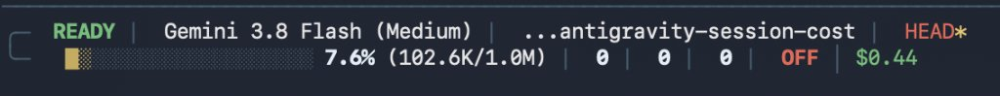
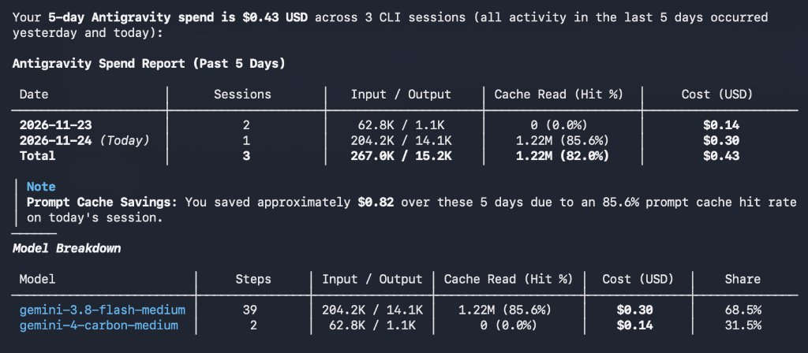

# antigravity-session-cost

> [!IMPORTANT]  
> This project is not provided by Google and does not come with any support or warranties. This project serves as a proof of concept for how it's possible to implement local session cost tracking and spend reporting with Antigravity.  
> Though functional, you may wish to change the design for increased reliability or feature detail.  

> [!IMPORTANT]  
> Accurate as of 11/24/2026

> [!NOTE]
> Bundled prices reflect illustrative public Gemini Enterprise Agent Platform (Vertex AI) list rates and are local estimates rather than billing invoices.

## What this is

A zero-dependency Python 3.11+ toolkit and Antigravity CLI (`agy`) skill that computes live USD session spend for your `statusLine` — including recursive rollups across locally spawned subagents and Swarm workers.

## Live Examples

### 1. Live Session Cost in `statusLine`
Appended non-destructively to an existing custom `statusLine` via `statusline_wrapper.sh`:



### 2. Historical Spend & Per-Model Breakdown (`/antigravity-session-cost`)
Multi-day summary with flat subagent deduplication, prompt-cache savings, and per-model share:



## Why this exists

Antigravity CLI records per-step token telemetry (`input_tokens`, `cache_read_tokens`, `output_tokens`, and `model`) in local `transcript.jsonl` logs, but does not always surface a populated `cost.total_usd` in `statusLine` payloads — especially across negotiated enterprise rate cards or multi-agent subagent/Swarm runs. This repo bridges that gap locally without overwriting existing `statusLine` scripts or adding runtime dependencies.

## What this is not / Limitations

- **Estimate, not an invoice**: Cost figures are computed from local token counts and configured per-1M token rates. Rounding, billing-tier edge cases, storage/grounding fees, and Vertex AI invoice adjustments are not modeled.
- **Local subagents and Swarm workers only**: Recursive rollup walks child `transcript.jsonl` files present under the local `<appDataDir>/brain/` tree. Remote/cloud workers whose transcripts are not stored locally are not included.
- **No live network calls during `statusLine` render**: Remote rate cards are only fetched via `--refresh-rates` or an optional `SessionStart` hook; `statusLine` always reads from local cache or bundled rates.
- **Native passthrough by default**: If Antigravity CLI populates a non-zero `cost.total_usd` in the `statusLine` stdin payload, `session_cost.py` passes it through unless `--force-local` is set.

## How it works

- incremental byte-offset parser (`skills/antigravity-session-cost/scripts/session_cost.py`) reads only newly appended complete JSONL lines from `transcript.jsonl` and persists per-transcript deltas (`cache_version: 2` with per-step timestamps) under `~/.cache/antigravity-session-cost/transcripts/`
- recursive child walker discovers subagent and Swarm worker `conversationId` UUIDs from tool calls/responses, traverses local child transcripts with cycle protection (`visited` set + `max_depth`), and splits `main_usd` vs `subagent_usd`
- flat historical scanner (`--report 1d|7d|30d|all`) reads each local `transcript.jsonl` once to guarantee zero double-counting of subagents, groups daily spend in your local timezone, computes prompt-cache savings, and breaks down spend by raw model ID
- layered pricing engine resolves models against `skills/antigravity-session-cost/config/rate_card.json` (exact key -> longest substring match -> `default_fallback` with `~$` estimated flag), applies `>200K` prompt-size tier switching (`input_tokens + cache_read_tokens > 200000`), and applies global or per-model discounts
- composable shell wrapper (`skills/antigravity-session-cost/scripts/statusline_wrapper.sh`) tees `statusLine` stdin JSON to any existing `statusLine` command and appends `│ $0.42 (sub $0.11)` with configurable ANSI spend color thresholds without modifying the original script
- turnkey standalone status line (`skills/antigravity-session-cost/scripts/statusline_standalone.sh`) and optional `SessionStart`/`Stop` lifecycle hook (`skills/antigravity-session-cost/scripts/stop_hook.sh`) for sub-5ms cached renders and background ETag rate-card refreshes
- 3-tier config precedence (`env` > `/etc/antigravity-session-cost/config.json` > `~/.config/antigravity-session-cost/config.json`) with stdlib-only GCS/HTTPS ETag (`If-None-Match` / `304 Not Modified`) caching and fail-open offline fallback

## Repository Layout

`skills/antigravity-session-cost/` is 100% self-contained so it works identically whether installed as a standalone skill (`npx skills add`), an Antigravity CLI plugin (`agy plugin install`), or a local git checkout (`./scripts/install.sh`).

```text
.
├── plugin.json                              # Antigravity CLI plugin manifest
├── README.md
├── LICENSE                                  # Apache-2.0
├── docs/
│   └── images/                              # README screenshots
│       ├── statusline-cost.jpg              # Live statusLine spend badge example
│       └── spend-report-5d.jpg              # 5-day spend & per-model breakdown example
├── skills/
│   └── antigravity-session-cost/            # Self-contained runtime skill bundle
│       ├── SKILL.md
│       ├── config/
│       │   └── rate_card.json               # Bundled Vertex AI list pricing
│       └── scripts/
│           ├── session_cost.py              # Zero-dep Python 3.11+ engine
│           ├── statusline_wrapper.sh        # Non-destructive statusLine wrapper
│           ├── statusline_standalone.sh     # Turnkey standalone statusLine
│           └── stop_hook.sh                 # Optional SessionStart / Stop hook
├── scripts/
│   ├── install.sh                           # Local & MDM/devcontainer installer
│   ├── deploy_gcs.sh                        # 30-second private GCS rate-card deployer
│   └── teardown_gcs.sh                      # Private GCS bucket cleanup
├── terraform/                               # Enterprise IaC for private GCS rate card
│   ├── main.tf
│   ├── variables.tf
│   ├── outputs.tf
│   └── terraform.tfvars.example
└── tests/
    └── test_session_cost.py                 # pytest unit & integration suite
```

## Quick Start

### Option A: Install as an Antigravity CLI Plugin (`agy plugin install`, Recommended)

Install the plugin, then wire `statusLine` directly with `install.sh` (avoids agent permission prompts and token spend):

```bash
agy plugin install https://github.com/alanblythe/antigravity-session-cost

# Standalone statusLine (if you do not have an existing statusLine):
~/.gemini/config/plugins/antigravity-session-cost/scripts/install.sh --mode standalone

# Or wrap an existing statusLine without modifying it:
~/.gemini/config/plugins/antigravity-session-cost/scripts/install.sh --mode wrapper

# Optional: apply a negotiated discount (e.g. 15%) or custom --gemini-dir
~/.gemini/config/plugins/antigravity-session-cost/scripts/install.sh --mode standalone --discount-pct 15
```

*(Optional)* Instead of running `install.sh`, you can ask Antigravity CLI (`agy`) to audit and configure your `statusLine` interactively:

```text
Set up antigravity-session-cost for my statusLine and apply a 15% discount.
```

### Option B: Install as a Skill (`npx skills add`)

Install the self-contained skill directly into Antigravity CLI:

```bash
npx skills add alanblythe/antigravity-session-cost --agent antigravity
```

Then ask Antigravity CLI (`agy`):

```text
Set up antigravity-session-cost for my statusLine and apply a 15% discount.
```

> **Note:** If Antigravity CLI prompts for or blocks permissions when editing `~/.gemini/antigravity-cli/settings.json`, use **Option A** with `install.sh`, or set `statusLine.command` manually to `~/.gemini/config/skills/antigravity-session-cost/scripts/statusline_standalone.sh` (or `statusline_wrapper.sh`).

### Option C: Clone & Local Installer (`git clone` + `./scripts/install.sh`)

Clone the repo and symlink the skill (or wire `statusLine` directly):

```bash
git clone https://github.com/alanblythe/antigravity-session-cost.git
cd antigravity-session-cost

# Skill-only (recommended: let the agent audit your existing statusLine first)
./scripts/install.sh --mode skill-only

# Or wrap an existing statusLine without modifying it:
./scripts/install.sh --mode wrapper

# Or install the standalone statusLine (model, context %, git branch, subagent count, cost):
./scripts/install.sh --mode standalone
```

Test against any local transcript:

```bash
python3 skills/antigravity-session-cost/scripts/session_cost.py \
  --transcript ~/.gemini/antigravity-cli/brain/<conversation-id>/.system_generated/logs/transcript.jsonl \
  --breakdown
```

## How to Use the Skill (`/antigravity-session-cost`)

Once installed, invoke `/antigravity-session-cost` inside Antigravity CLI (or ask in plain language):

| Goal | Example Prompt | What the Skill Does |
| :--- | :--- | :--- |
| **Wire up `statusLine`** | *"Set up session cost in my status line"* | Audits `settings.json` and any existing statusline script, then offers a non-destructive **Composable Wrapper**, **In-Place Diff Patch**, **Standalone Bar**, or **Stop-Hook Cache** mode. |
| **Check historical spend** | *"What did I spend over the last 7 days?"* | Runs `session_cost.py --report 7d` (also supports `1d`, `30d`, `all`) and renders daily spend, prompt-cache savings, and a per-model breakdown. |
| **Inspect current session** | *"Break down this session's cost by model"* | Runs `session_cost.py --breakdown` showing main vs. subagent spend and per-model token/cost share. |
| **Apply org discounts** | *"Apply our 15% Vertex discount to the rate card"* | Updates `global_discount_pct` or per-model `overrides` in `~/.config/antigravity-session-cost/rate_card.json` without clobbering base list prices. |
| **Connect a fleet rate card** | *"Point my cost tracker to our GCS rate card"* | Configures `rate_card_url` (`gs://...` or `https://...`) and primes the local ETag cache. |

## Historical Spend Reports & Per-Model Breakdown

Generate daily and per-model spend tables (including prompt-cache hit rate and estimated cache savings) across your local transcripts without double-counting subagent or Swarm transcripts:

```bash
# Today, last 7 days, last 30 days, or full local history
python3 skills/antigravity-session-cost/scripts/session_cost.py --report 1d
python3 skills/antigravity-session-cost/scripts/session_cost.py --report 7d
python3 skills/antigravity-session-cost/scripts/session_cost.py --report 30d
python3 skills/antigravity-session-cost/scripts/session_cost.py --report all

# Custom --gemini-dir / --brain-dir, multi-surface scan, or JSON output
python3 skills/antigravity-session-cost/scripts/session_cost.py --report 7d --gemini-dir ~/.antigravity
python3 skills/antigravity-session-cost/scripts/session_cost.py --report 7d --brain-dir ~/.antigravity/antigravity-cli/brain
python3 skills/antigravity-session-cost/scripts/session_cost.py --report 30d --all-surfaces --format json
```

For a single conversation, pass `--breakdown` to print Main vs. Subagents spend, token totals, prompt-cache savings, and a per-model share table:

```bash
python3 skills/antigravity-session-cost/scripts/session_cost.py \
  --transcript ~/.gemini/antigravity-cli/brain/<conversation-id>/.system_generated/logs/transcript.jsonl \
  --breakdown
```

### Deterministic Active-Instance Resolution

`--report` strictly resolves **one** Antigravity config root (never silently merging `~/.gemini` and `~/.antigravity`) so spend reports never bleed across isolated instances:

1. Explicit `--brain-dir`
2. Explicit `--transcript` parent `brain/` (when `--all-surfaces` is not set)
3. Explicit `--gemini-dir` CLI flag or `AGY_COST_GEMINI_DIR` / `GEMINI_DIR` environment variable
4. Active ancestor process (`agy` or `language_server*` `--gemini_dir` / `--config_dir` flag, or `~/.gemini` if launched without a custom directory flag)
5. Configured `"gemini_dir"` in `~/.config/antigravity-session-cost/config.json` (used for standalone shell runs outside `agy`)
6. `~/.gemini` single deterministic fallback

When `--all-surfaces` is passed, `session_cost.py` scans `antigravity-cli/brain`, `antigravity/brain`, and `antigravity-ide/brain` strictly within that single resolved config root.

## StatusLine Color Thresholds

When rendering ANSI badges (`--format badge`, the default for `statusLine`), spend color shifts automatically based on two optional environment variables:

| Spend Range | ANSI Color | Environment Variable | Default |
| :--- | :--- | :--- | :--- |
| `< warn` | Bright Green (`\033[92m`) | — | `< $1.00` |
| `>= warn` and `< high` | Bright Yellow (`\033[93m`) | `AGY_COST_WARN_USD` | `1.00` |
| `>= high` | Bright Red (`\033[91m`) | `AGY_COST_HIGH_USD` | `5.00` |

## Example Rate Card (`rate_card.json`)

The rate card separates base list prices (`models`) from organization discounts (`global_discount_pct`) and per-model negotiated rates (`overrides`), so upstream list-price updates do not overwrite custom discounts:

```json
{
  "schema_version": "1.0",
  "updated_at": "2026-11-23",
  "currency": "USD",
  "source": "Vertex AI public list prices (per 1M tokens, USD)",
  "global_discount_pct": 15.0,
  "default_tier_threshold_tokens": 200000,
  "models": {
    "gemini-4-carbon": {
      "match": ["gemini-4-carbon", "4-carbon"],
      "input": 2.00,
      "output": 10.00,
      "cache_read": 0.10,
      "gt_200k_input": 4.00,
      "gt_200k_output": 15.00,
      "gt_200k_cache_read": 0.20
    },
    "gemini-4-hydrogen": {
      "match": ["gemini-4-hydrogen", "4-hydrogen"],
      "input": 1.50,
      "output": 7.50,
      "cache_read": 0.075,
      "gt_200k_input": 3.00,
      "gt_200k_output": 11.25,
      "gt_200k_cache_read": 0.15
    },
    "gemini-3.8-flash": {
      "match": ["gemini-3.8-flash", "3.8-flash"],
      "input": 0.75,
      "output": 3.75,
      "cache_read": 0.075
    },
    "default_fallback": {
      "match": ["*"],
      "input": 2.00,
      "output": 10.00,
      "cache_read": 0.10
    }
  },
  "overrides": {
    "gemini-4-carbon": {
      "discount_pct": 20.0
    }
  }
}
```

## Fleet Deployment (Private GCS + ADC + ETag Caching)

Organizations can publish a single negotiated `rate_card.json` to a private Google Cloud Storage bucket (or an internal HTTPS endpoint) and point developer workstations or devcontainers at it.

Both deployment paths below enforce **Uniform Bucket-Level Access**, **Public Access Prevention (`enforced`)**, and **Object Versioning**, and grant least-privilege `roles/storage.objectViewer` to specific IAM principals (`user:`, `group:`, `serviceAccount:`) for Application Default Credentials (ADC) — compliant with **Domain Restricted Sharing (DRS)** and enterprise org policies (never `allUsers` or `allAuthenticatedUsers`).

### 1. Provision the private GCS bucket and upload `rate_card.json`

#### Path A: 30-second PoC (`scripts/deploy_gcs.sh`)

```bash
./scripts/deploy_gcs.sh \
  --project <YOUR_PROJECT_ID> \
  --bucket <YOUR_BUCKET_NAME> \
  --region us-central1 \
  --reader group:eng@example.com
```

`deploy_gcs.sh` idempotently creates the private bucket, enables versioning, uploads `skills/antigravity-session-cost/config/rate_card.json` with `application/json` and `private, max-age=300` headers, grants `roles/storage.objectViewer` for each `--reader` flag (repeatable), and prints the exact workstation install command.

Clean up the PoC bucket (including all object versions) when finished:

```bash
./scripts/teardown_gcs.sh --project <YOUR_PROJECT_ID> --bucket <YOUR_BUCKET_NAME>
```

#### Path B: Enterprise IaC (`terraform/`)

For teams managing infrastructure with Terraform or OpenTofu:

```bash
cd terraform
cp terraform.tfvars.example terraform.tfvars
# Edit terraform.tfvars with your project_id, bucket_name, and reader_members
terraform init
terraform apply
terraform output install_command
```

Workstations authenticate via Application Default Credentials (`gcloud auth application-default login` or `gcloud auth login`).

### 2. Deploy non-interactively (MDM / devcontainer / dotfiles)

```bash
./scripts/install.sh \
  --rate-card-url gs://<YOUR_BUCKET_NAME>/rate_card.json \
  --mode wrapper \
  --non-interactive \
  --auth-mode adc
```

For system-wide MDM policy enforcement across all users on a machine, drop a config file at `/etc/antigravity-session-cost/config.json`:

```json
{
  "rate_card_url": "gs://<YOUR_BUCKET_NAME>/rate_card.json",
  "rate_card_ttl_seconds": 86400,
  "auth_mode": "adc"
}
```

### 3. Refresh out-of-band

`skills/antigravity-session-cost/scripts/stop_hook.sh session-start` (or a manual `python3 skills/antigravity-session-cost/scripts/session_cost.py --refresh-rates`) validates the cached `ETag` with `If-None-Match`:
- `200 OK`: atomically updates `~/.cache/antigravity-session-cost/rate_card.json`
- `304 Not Modified`: extends the TTL without rewriting the file
- Offline / error: fails open to the last cached remote rate card, then `~/.config/antigravity-session-cost/rate_card.json`, then bundled list prices

### Configuring the Rate Card Source (Precedence & Refresh)

`session_cost.py` resolves where the rate card comes from in strict precedence order (highest wins):

| Priority | Mechanism | Example | Best For |
| :---: | :--- | :--- | :--- |
| **1** | **CLI Flags** | `--rate-card <path>` / `--rate-card-url gs://<bucket>/rate_card.json` | One-off overrides & manual `--refresh-rates` |
| **2** | **Environment Variables** | `AGY_COST_RATE_CARD_URL="gs://<bucket>/rate_card.json"`<br>`AGY_COST_RATE_CARD="/path/to/rate_card.json"`<br>`AGY_COST_RATE_CARD_TTL=86400`<br>`AGY_COST_DISCOUNT_PCT=15`<br>`AGY_COST_RATE_CARD_TOKEN="<bearer-token>"`<br>`AGY_COST_RATE_CARD_AUTH_HEADER="X-Api-Key: ..."` | Devcontainers, CI, & custom launcher wrappers |
| **3** | **System / MDM Config** | `/etc/antigravity-session-cost/config.json` | Fleet-wide corporate laptops (zero-touch) |
| **4** | **User Config** | `~/.config/antigravity-session-cost/config.json` | Individual developers (`install.sh` or `/antigravity-session-cost`) |
| **5** | **Bundled Fallback** | `skills/antigravity-session-cost/config/rate_card.json` | Offline / zero-config default list prices |

- **Auth (`gs://` & HTTPS)**: Any `gs://` URI automatically uses the workstation's existing GCP ADC (`gcloud auth application-default print-access-token`) — zero separate API keys or secrets to distribute. For private HTTPS endpoints, set `AGY_COST_RATE_CARD_TOKEN` (`Authorization: Bearer ...`) or `AGY_COST_RATE_CARD_AUTH_HEADER` (`Header-Name: value`).
- **ETag Caching & Offline Fail-Open**: Remote cards are cached at `~/.cache/antigravity-session-cost/rate_card.json` alongside `rate_card.meta.json` (`ETag` + timestamp). Refreshes send `If-None-Match` (`304 Not Modified`) and silently fall back to the cached or bundled card if offline.
- **When Refreshes Run**: Never inside `statusLine` (keeps renders `<5ms`). Refreshes trigger during `install.sh`, via the optional `SessionStart` hook (`stop_hook.sh session-start`), or manually via `session_cost.py --refresh-rates`.

## Testing

Run the unit and integration test suite with `pytest`:

```bash
pytest -v tests/test_session_cost.py
```
